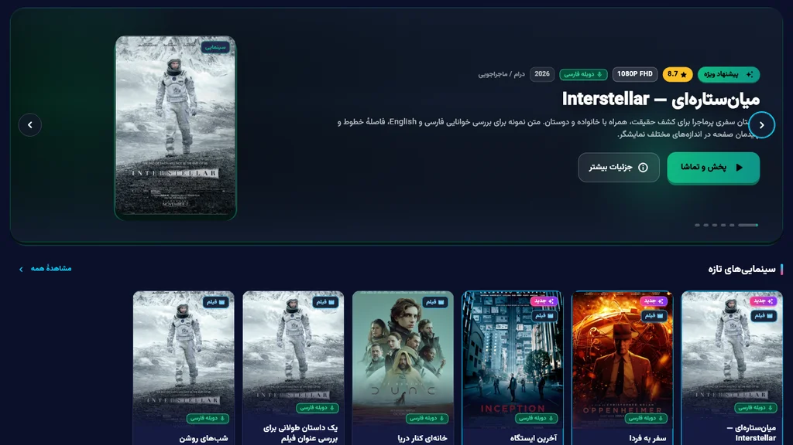
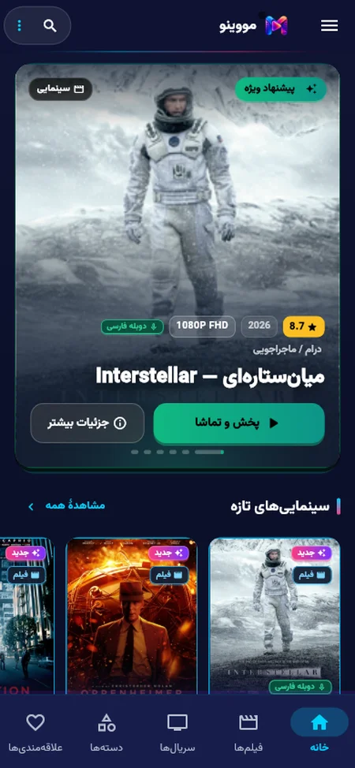
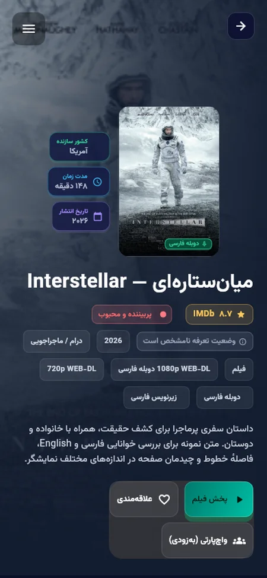

# مووینو | Movino — دریافت رسمی

مووینو یک اپلیکیشن تماشای فیلم و سریال برای موبایل اندروید، تلویزیون Android TV و دسکتاپ است. این مخزن، صفحهٔ رسمی دانلود و انتشار فایل‌های نصب مووینو است؛ **سورس اپلیکیشن و پنل در این مخزن منتشر نمی‌شود.**

- **صفحهٔ رسمی دانلود:** <https://movinoofficial.github.io/movino-downloads/>
- **آخرین نسخه و همهٔ فایل‌ها:** <https://github.com/movinoOfficial/movino-downloads/releases/latest>
- **یادداشت انتشار:** در توضیحات صفحهٔ هر Release
- **کانال رسمی و پشتیبانی:** <https://t.me/MovinoOfficial>
- **وب‌اپ:** <https://t.me/MovinoBot/app>

## انتخاب فایل مناسب

| دستگاه | فایل پیشنهادی | توضیح |
| --- | --- | --- |
| موبایل و تبلت Android | `Movino-*-universal.apk` | انتخاب ساده برای بیشتر دستگاه‌های پشتیبانی‌شده |
| Android TV و TV Box | `Movino-*-Android-TV.apk` | چیدمان و کنترل مناسب تلویزیون و ریموت |
| دستگاه‌های Android با پردازندهٔ ARM64 | `Movino-*-arm64-v8a.apk` | نسخهٔ جداگانهٔ ۶۴ بیتی |
| دستگاه‌های Android قدیمی‌تر با ARMv7 | `Movino-*-armeabi-v7a.apk` | نسخهٔ جداگانهٔ ۳۲ بیتی |
| دستگاه‌های Android مبتنی بر x86_64 | `Movino-*-x86_64.apk` | نسخهٔ جداگانه برای این معماری |
| Windows | `Movino_Setup_*.exe` | نصب معمول ویندوز |
| Windows، بدون نصب | `Movino-Windows-*-Portable.zip` | نسخهٔ قابل‌حمل؛ فایل ZIP را استخراج و برنامه را اجرا کنید |
| Debian / Ubuntu، ۶۴ بیتی | `movino_*_amd64.deb` | بستهٔ نصب Debian |
| توزیع‌های Linux، x86_64 | `Movino-*-x86_64.AppImage` | بستهٔ مستقل AppImage |

نام دقیق و نسخهٔ فایل‌ها را در [آخرین انتشار](https://github.com/movinoOfficial/movino-downloads/releases/latest) ببینید. اگر دربارهٔ معماری Android مطمئن نیستید، ابتدا نسخهٔ Universal را انتخاب کنید.

## نصب و بررسی فایل

1. فایل متناسب با دستگاه را فقط از [صفحهٔ دانلود رسمی](https://movinoofficial.github.io/movino-downloads/) یا [GitHub Releases مووینو](https://github.com/movinoOfficial/movino-downloads/releases) دریافت کنید.
2. برای Android، فایل APK را باز کنید و در صورت درخواست سیستم، اجازهٔ نصب برنامه از همان منبع دانلود را فعال کنید. برای تلویزیون، APK مخصوص Android TV را انتخاب کنید.
3. در Windows از فایل Setup برای نصب استفاده کنید؛ برای نسخهٔ بدون نصب، ZIP را استخراج کنید.
4. در Linux، فایل DEB را با ابزار نصب بستهٔ توزیع خود نصب کنید یا مجوز اجرا را به AppImage بدهید و آن را اجرا کنید.
5. برای بررسی یکپارچگی فایل، `checksums.txt` همان Release را هم بگیرید. مقدار SHA-256 نمایش‌داده‌شده را با مقدار مقابل نام همان فایل در فهرست مقایسه کنید. در Linux:

   ```bash
   sha256sum Movino_Setup_v1.0.0.exe
   ```

   در Windows PowerShell:

   ```powershell
   Get-FileHash .\Movino_Setup_v1.0.0.exe -Algorithm SHA256
   ```

## تصاویر اپلیکیشن

### محیط تلویزیون



### محیط موبایل

| صفحهٔ اصلی | جزئیات فیلم |
| --- | --- |
|  |  |

## انتشارهای جدید

فایل‌های نصب و یادداشت‌های نسخه در GitHub Releases نگهداری می‌شوند؛ APK و بسته‌های حجیم در تاریخچهٔ Git قرار نمی‌گیرند. برای دریافت به‌روزرسانی، همیشه [آخرین نسخه](https://github.com/movinoOfficial/movino-downloads/releases/latest) را باز کنید.

## English

**Movino** is a movie and series streaming app for Android phones and tablets, Android TV, Windows, and Linux. This is the official downloads and release repository. **The application and admin-panel source code are not published here.**

- Official downloads: <https://movinoofficial.github.io/movino-downloads/>
- Latest release and installers: <https://github.com/movinoOfficial/movino-downloads/releases/latest>
- Web app: <https://t.me/MovinoBot/app>
- Official Telegram and support: <https://t.me/MovinoOfficial>

Choose the Universal APK for most Android devices, the Android TV APK for televisions and TV boxes, or an ABI-specific APK when needed. Windows installers and portable ZIP, Debian packages, AppImage builds, and SHA-256 checksums are listed on each release page.
